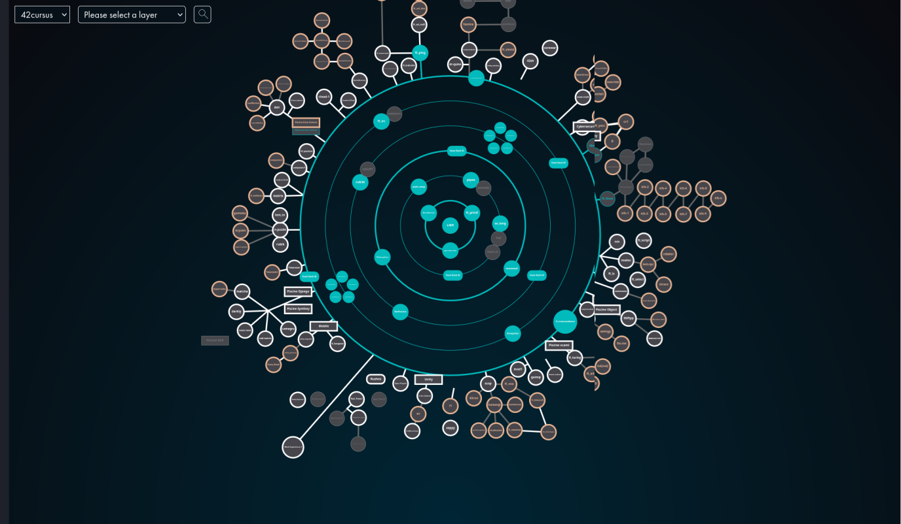
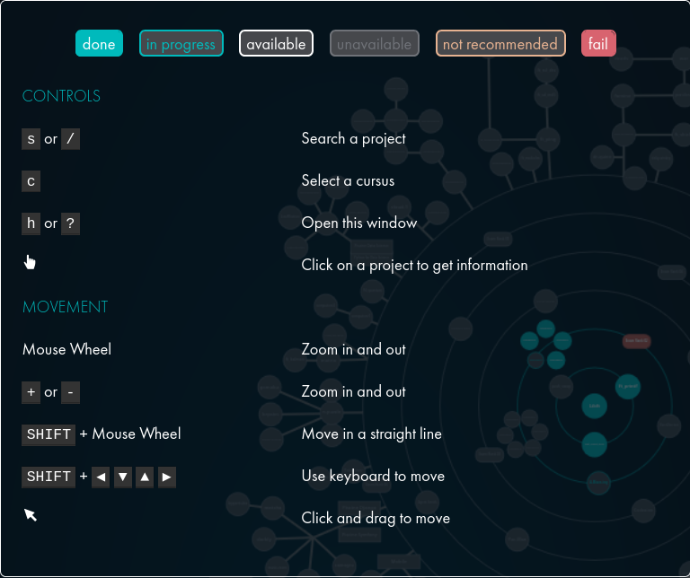
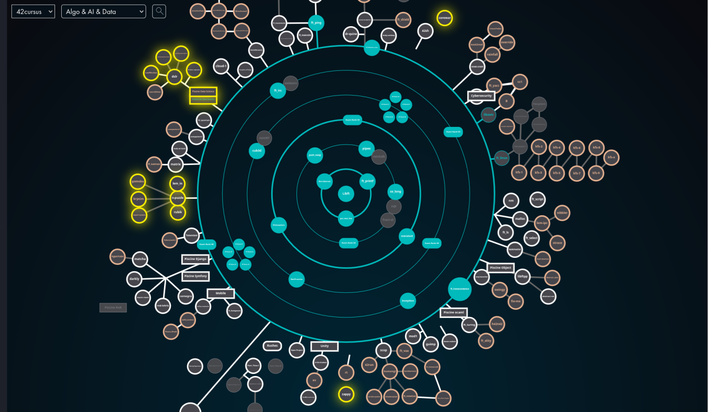
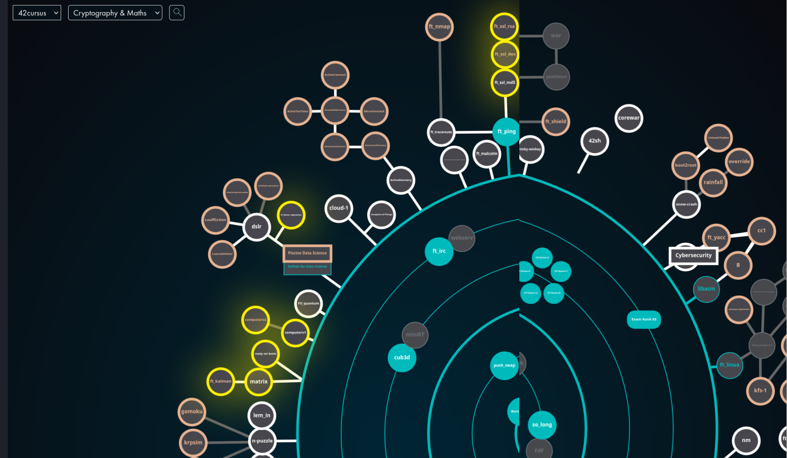
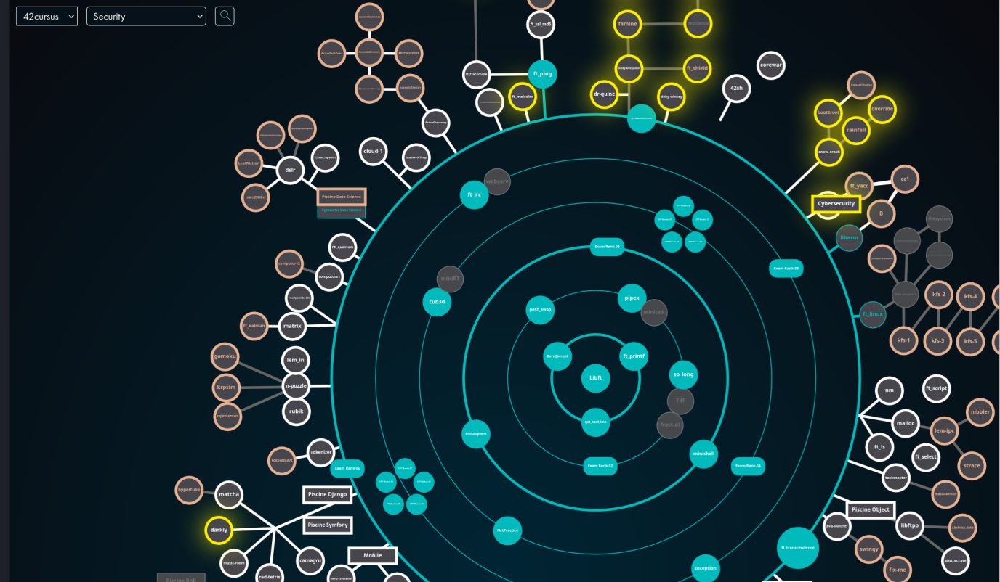
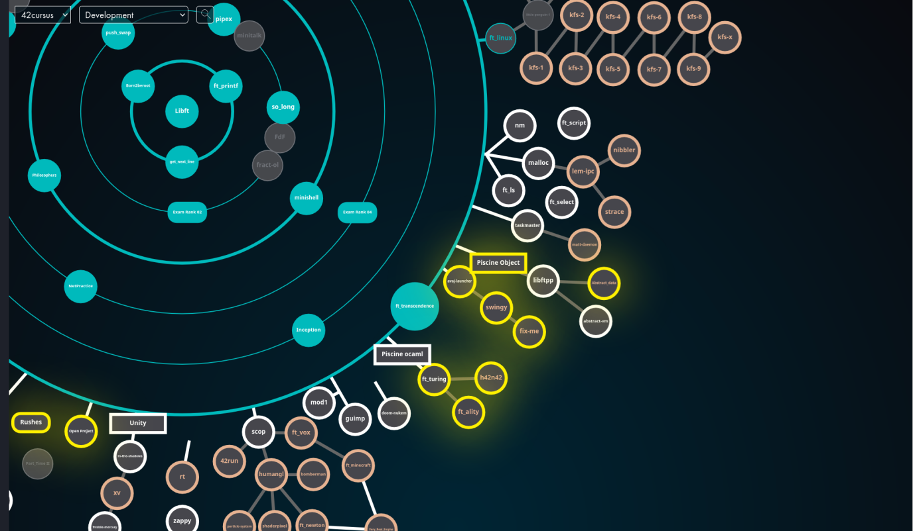
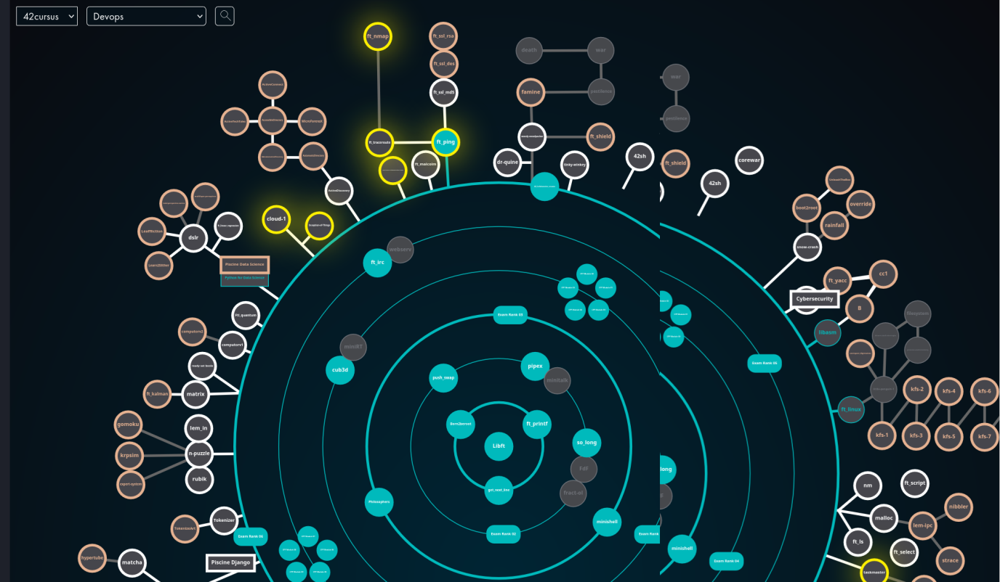
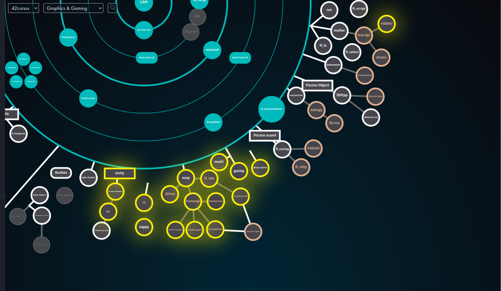
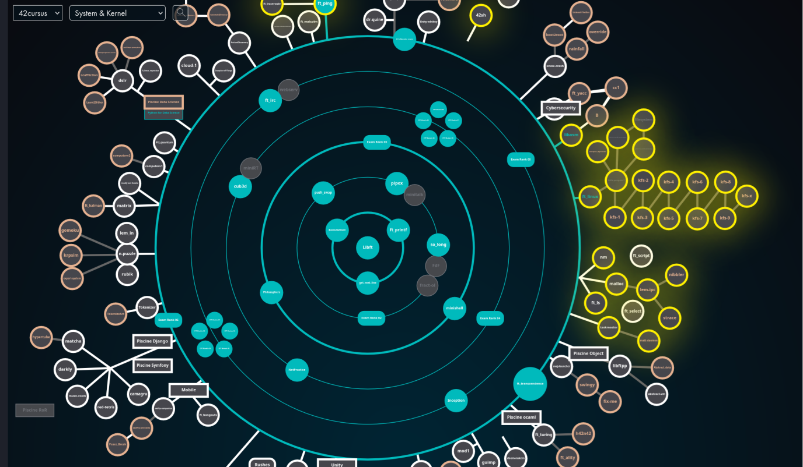
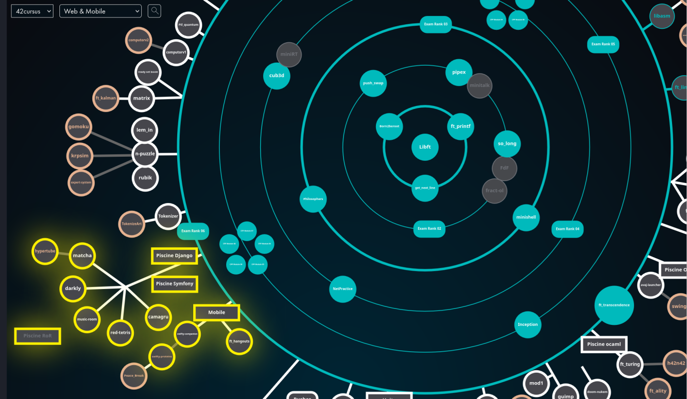

# 42 School — Complete Curriculum Archive

> A comprehensive collection of **42 School** project subjects (PDFs), resources, and starter materials covering the entire curriculum — from the C Piscine to advanced specializations.

---

## Table of Contents

- [Holy Graph](#-holy-graph)
- [Overview](#overview)
- [Repository Structure](#repository-structure)
- [Global Projects](#-global-projects)
- [Pool (Piscine) Projects](#-pool-piscine-projects)
  - [C Pool](#c-pool)
  - [C++ Pool](#c-pool-1)
  - [Python for Data Science](#python-for-data-science)
  - [Data Science Pool](#data-science-pool)
  - [Django Pool](#django-pool)
  - [Ruby on Rails Pool](#ruby-on-rails-pool)
  - [Symfony Pool](#symfony-pool)
  - [OCaml Pool](#ocaml-pool)
  - [Unity Pool](#unity-pool)
- [Unix Branch](#-unix-branch)
- [Specializations](#-specializations)
  - [Algo, AI & Data](#algo-ai--data)
  - [Cryptography & Maths](#cryptography--maths)
  - [Cybersecurity](#cybersecurity)
  - [Development](#development)
  - [DevOps](#devops)
  - [Graphics & Gaming](#graphics--gaming)
  - [System & Kernel](#system--kernel)
  - [Web & Mobile](#web--mobile)
- [File Types](#file-types)
- [How to Use](#how-to-use)
- [Disclaimer](#disclaimer)

---

## 🗺 Holy Graph

The **Holy Graph** is the visual roadmap of the entire 42 curriculum. It shows how projects connect, unlock, and branch into specializations.

<p align="center">
  
</p>

<details>
<summary>📘 Legend</summary>
<p align="center">
  
</p>
</details>

---

## Overview

This repository contains **215+ subject PDFs** and **60+ resource archives** spanning the complete 42 School pedagogy. The curriculum is organized into four main sections:

| Section | Description | Projects |
|---------|-------------|----------|
| **Global** | Foundational C projects required by all students | 2 |
| **Pool** | Intensive bootcamp modules (Piscines) across 9 tracks | ~80 |
| **Unix Branch** | Core Unix/systems programming projects | 30 |
| **Specialization** | Advanced elective tracks in 8 domains | ~100 |

---

## Repository Structure

```
42/
├── Global/                  # Mandatory foundational projects
│   ├── Libft/               # Custom C library
│   └── get_next_line/       # Line-by-line file reader
│
├── Pool/                    # Piscine (Bootcamp) modules
│   ├── C Pool/              # 14 C exercises + 2 Shell modules
│   ├── CPP Pool/            # 9 C++ OOP modules (00–08)
│   ├── Python_for_Data_Science/  # 5 Python modules
│   ├── Piscine_Data_Science/     # 2 Data Science modules
│   ├── Django Pool/         # 9 Django web framework modules
│   ├── RoR Pool/            # 8 Ruby on Rails modules
│   ├── Pool Symfony/        # 9 Symfony PHP framework modules
│   ├── Ocaml Pool/          # 9 functional programming modules
│   └── Unity Pool/          # 7 game development modules
│
├── Unix branch/             # Core Unix/systems projects
│   ├── minishell/           # Shell implementation
│   ├── Philosophers/        # Threading & synchronization
│   ├── ft_transcendence/    # Full-stack web application
│   └── ...                  # 27 more projects
│
└── Specialization/          # Advanced elective tracks
    ├── Algo & AI & Data/    # 13 projects
    ├── Cryptography & Maths/# 8 projects
    ├── Cybersecurity/       # 18 projects
    ├── Development/         # 7 projects
    ├── Devops/              # 6 projects
    ├── Graphics & Gaming/   # 15 projects
    ├── System & Kernel/     # 23 projects
    └── Web & Mobile/        # 9 projects
```

---

## 🟢 Global Projects

Mandatory projects that every 42 student must complete.

| Project | Subject | Description |
|---------|---------|-------------|
| **Libft** | [en.subject.pdf](Global/Libft/en.subject.pdf) | Build your own C standard library from scratch — string manipulation, memory management, linked lists |
| **get_next_line** | [en.subject.pdf](Global/get_next_line/en.subject.pdf) | Implement a function that reads a file descriptor line by line using static variables |

---

## 🔵 Pool (Piscine) Projects

Intensive bootcamp modules designed to build foundational skills in a specific technology.

### C Pool

14 progressive C programming exercises + 2 Shell scripting modules.

| Module | Subject | Topic |
|--------|---------|-------|
| C Piscine C 00 | [en.subject.pdf](Pool/C%20Pool/C%20Piscine%20C%2000%20/en.subject.pdf) | C basics — variables, loops, conditions |
| C Piscine C 01 | [en.subject.pdf](Pool/C%20Pool/C%20Piscine%20C%2001%20/en.subject.pdf) | Pointers & arrays |
| C Piscine C 02 | [en.subject.pdf](Pool/C%20Pool/C%20Piscine%20C%2002%20/en.subject.pdf) | Strings & string functions |
| C Piscine C 03 | [en.subject.pdf](Pool/C%20Pool/C%20Piscine%20C%2003%20/en.subject.pdf) | String comparison & search |
| C Piscine C 04 | [en.subject.pdf](Pool/C%20Pool/C%20Piscine%20C%2004%20/en.subject.pdf) | Number manipulation & conversion |
| C Piscine C 05 | [en.subject.pdf](Pool/C%20Pool/C%20Piscine%20C%2005%20/en.subject.pdf) | Recursion & iterative functions |
| C Piscine C 06 | [en.subject.pdf](Pool/C%20Pool/C%20Piscine%20C%2006%20/en.subject.pdf) | Program arguments (argc/argv) |
| C Piscine C 07 | [en.subject.pdf](Pool/C%20Pool/C%20Piscine%20C%2007%20/en.subject.pdf) | Dynamic memory allocation (malloc) |
| C Piscine C 08 | [en.subject.pdf](Pool/C%20Pool/C%20Piscine%20C%2008%20/en.subject.pdf) | Headers, macros & preprocessor |
| C Piscine C 09 | [en.subject.pdf](Pool/C%20Pool/C%20Piscine%20C%2009%20/en.subject.pdf) | Makefiles & compilation |
| C Piscine C 10 | [en.subject.pdf](Pool/C%20Pool/C%20Piscine%20C%2010%20/en.subject.pdf) | File I/O operations |
| C Piscine C 11 | [en.subject.pdf](Pool/C%20Pool/C%20Piscine%20C%2011/en.subject.pdf) | Function pointers |
| C Piscine C 12 | [en.subject.pdf](Pool/C%20Pool/C%20Piscine%20C%2012%20/en.subject.pdf) | Linked lists |
| C Piscine C 13 | [en.subject.pdf](Pool/C%20Pool/C%20Piscine%20C%2013%20/en.subject.pdf) | Binary trees |
| Shell 00 | [en.subject.pdf](Pool/C%20Pool/C%20Piscine%20Shell%2000/en.subject.pdf) | Shell basics & commands *(includes [resources.tar.gz](Pool/C%20Pool/C%20Piscine%20Shell%2000/resources.tar.gz))* |
| Shell 01 | [en.subject.pdf](Pool/C%20Pool/C%20Piscine%20Shell%2001%20/en.subject.pdf) | Advanced shell scripting |

### C++ Pool

9 modules covering Object-Oriented Programming in C++98.

| Module | Subject | Topic |
|--------|---------|-------|
| CPP Module 00 | [en.subject.pdf](Pool/CPP%20Pool/CPP_Module_00/en.subject.pdf) | Namespaces, classes, member functions, stdio streams |
| CPP Module 01 | [en.subject.pdf](Pool/CPP%20Pool/CPP_Module_01/en.subject.pdf) | Memory allocation, pointers to members, references, switch |
| CPP Module 02 | [en.subject.pdf](Pool/CPP%20Pool/CPP_Module_02/en.subject.pdf) | Ad-hoc polymorphism, operator overloading, canonical form |
| CPP Module 03 | [en.subject.pdf](Pool/CPP%20Pool/CPP_Module_03/en.subject.pdf) | Inheritance |
| CPP Module 04 | [en.subject.pdf](Pool/CPP%20Pool/CPP_Module_04/en.subject.pdf) | Subtype polymorphism, abstract classes, interfaces |
| CPP Module 05 | [en.subject.pdf](Pool/CPP%20Pool/CPP_Module_05/en.subject.pdf) | Exceptions |
| CPP Module 06 | [en.subject.pdf](Pool/CPP%20Pool/CPP_Module_06/en.subject.pdf) | C++ type casting |
| CPP Module 07 | [en.subject.pdf](Pool/CPP%20Pool/CPP_Module_07/en.subject.pdf) | Templates |
| CPP Module 08 | [en.subject.pdf](Pool/CPP%20Pool/CPP_Module_08/en.subject.pdf) | Templated containers, iterators, algorithms |

### Python for Data Science

5 modules introducing Python for scientific computing.

| Module | Subject | Topic |
|--------|---------|-------|
| Python 0 — Starting | [en.subject.pdf](Pool/Python_for_Data_Science/Python%200%20-%20Starting/en.subject.pdf) | Python basics & environment setup |
| Python 1 — Array | [en.subject.pdf](Pool/Python_for_Data_Science/Python%201%20-%20Array/en.subject.pdf) | NumPy arrays & operations |
| Python 2 — DataTable | [en.subject.pdf](Pool/Python_for_Data_Science/Python%202%20-%20DataTable/en.subject.pdf) | Pandas DataFrames *(includes [income.csv](Pool/Python_for_Data_Science/Python%202%20-%20DataTable/income_per_person_gdppercapita_ppp_inflation_adjusted.csv), [population.csv](Pool/Python_for_Data_Science/Python%202%20-%20DataTable/population_total.csv), [life_expectancy.csv](Pool/Python_for_Data_Science/Python%202%20-%20DataTable/life_expectancy_years.csv))* |
| Python 3 — OOP | [en.subject.pdf](Pool/Python_for_Data_Science/Python%203%20-%20OOP/en.subject.pdf) | Object-Oriented Programming in Python |
| Python 4 — Dod | [en.subject.pdf](Pool/Python_for_Data_Science/Python%204%20-%20Dod/en.subject.pdf) | Data-Oriented Design |

### Data Science Pool

| Module | Subject | Resources | Topic |
|--------|---------|-----------|-------|
| Data Science 0 | [en.subject.pdf](Pool/Piscine_Data_Science/Data_Science-0/en.subject.pdf) | [subject.zip](Pool/Piscine_Data_Science/Data_Science-0/subject.zip) | Data Science fundamentals |
| Data Science 2 | [en.subject.pdf](Pool/Piscine_Data_Science/Data_Science-2/en.subject.pdf) | [data_2023_feb.csv](Pool/Piscine_Data_Science/Data_Science-2/data_2023_feb.csv) | Advanced data science |

### Django Pool

9 modules for Python web development with Django. *(Subjects in French)*

| Module | Subject | Resources | Topic |
|--------|---------|-----------|-------|
| Django 0 — Initiation | [fr.subject.pdf](Pool/Django%20Pool/Django%20-%200%20-%20%20Initiation/fr.subject.pdf) | [d00.tar.gz](Pool/Django%20Pool/Django%20-%200%20-%20%20Initiation/d00.tar.gz) | Web basics & HTTP |
| Django 0 — Starting | [fr.subject.pdf](Pool/Django%20Pool/Django-0-Starting/fr.subject.pdf) | [d01.tar.gz](Pool/Django%20Pool/Django-0-Starting/d01.tar.gz) | Project setup |
| Django 0 — Oob | [fr.subject.pdf](Pool/Django%20Pool/Django-0-Oob/fr.subject.pdf) | [d02.tar.gz](Pool/Django%20Pool/Django-0-Oob/d02.tar.gz) | OOP refresher |
| Django 1 — Base Django | [fr.subject.pdf](Pool/Django%20Pool/Django-1-Base_Django/fr.subject.pdf) | — | Django fundamentals |
| Django 1 — Lib | [fr.subject.pdf](Pool/Django%20Pool/Django-1-Lib/fr.subject.pdf) | — | Libraries & packages |
| Django 2 — SQL | [fr.subject.pdf](Pool/Django%20Pool/Django-2-SQL/fr.subject.pdf) | [d05.tar.gz](Pool/Django%20Pool/Django-2-SQL/d05.tar.gz) | Database & ORM |
| Django 3 — Advanced | [fr.subject.pdf](Pool/Django%20Pool/Django-3-Advanced/fr.subject.pdf) | [ressources.tar.gz](Pool/Django%20Pool/Django-3-Advanced/ressources.tar.gz) | Advanced features |
| Django 3 — Sessions | [fr.subject.pdf](Pool/Django%20Pool/Django-3-Sessions/fr.subject.pdf) | — | Sessions & auth |
| Django 3 — Final | [fr.subject.pdf](Pool/Django%20Pool/Django-3-Final/fr.subject.pdf) | — | Final project |

### Ruby on Rails Pool

8 modules for web development with Ruby on Rails. *(Subjects in French)*

| Module | Subject | Resources | Topic |
|--------|---------|-----------|-------|
| RoR 0 — Initiation | [fr.subject.pdf](Pool/RoR%20Pool/RoR%20%200%20-%20Initiation/fr.subject.pdf) | [d00.tar.gz](Pool/RoR%20Pool/RoR%20%200%20-%20Initiation/d00.tar.gz) | Ruby basics |
| RoR 0 — Starting | [fr.subject.pdf](Pool/RoR%20Pool/RoR%200%20-%20Starting/fr.subject.pdf) | [d01.tar.gz](Pool/RoR%20Pool/RoR%200%20-%20Starting/d01.tar.gz) | Environment setup |
| RoR 0 — Oob | [fr.subject.pdf](Pool/RoR%20Pool/RoR%200%20-%20Oob/fr.subject.pdf) | [module02.1.1.tgz](Pool/RoR%20Pool/RoR%200%20-%20Oob/module02.1.1.tgz) | OOP in Ruby |
| RoR 1 — Base Rails | [fr.subject.pdf](Pool/RoR%20Pool/RoR%201%20-%20Base_Rails/fr.subject.pdf) | — | Rails fundamentals |
| RoR 1 — Gems | [fr.subject.pdf](Pool/RoR%20Pool/RoR%201%20-%20Gems/fr.subject.pdf) | [Module03.tar.gz](Pool/RoR%20Pool/RoR%201%20-%20Gems/Module03.tar.gz) | Gems & dependencies |
| RoR 2 — SQL | [en.subject.pdf](Pool/RoR%20Pool/Ror%202%20-%20SQL/en.subject.pdf) | [attachmentMd05.tar.gz](Pool/RoR%20Pool/Ror%202%20-%20SQL/attachmentMd05.tar.gz) | Database integration |
| RoR 3 — Advanced | [fr.subject.pdf](Pool/RoR%20Pool/RoR%203%20-%20Advanced/fr.subject.pdf) | [module07.1.1.tgz](Pool/RoR%20Pool/RoR%203%20-%20Advanced/module07.1.1.tgz) | Advanced Rails |
| RoR 3 — Sessions | [en.subject.pdf](Pool/RoR%20Pool/RoR%20%203%20-%20Sessions/en.subject.pdf) | [AttachmentMd06.tar.gz](Pool/RoR%20Pool/RoR%20%203%20-%20Sessions/AttachmentMd06.tar.gz) | Sessions & auth |

### Symfony Pool

9 modules for PHP web development with Symfony.

| Module | Subject | Resources | Topic |
|--------|---------|-----------|-------|
| Symfony 0 — Initiation | [fr.subject.pdf](Pool/Pool%20Symfony/Symfony%200%20-%20Initiation/fr.subject.pdf) | [d00.tar.gz](Pool/Pool%20Symfony/Symfony%200%20-%20Initiation/d00.tar.gz) | PHP basics |
| Symfony 0 — Starting | [fr.subject.pdf](Pool/Pool%20Symfony/Symfony%200%20-%20Starting/fr.subject.pdf) | [d01.tar.gz](Pool/Pool%20Symfony/Symfony%200%20-%20Starting/d01.tar.gz) | Environment setup |
| Symfony 0 — Oob | [fr.subject.pdf](Pool/Pool%20Symfony/Symfony%200%20-%20Oob/fr.subject.pdf) | [d02.tar.gz](Pool/Pool%20Symfony/Symfony%200%20-%20Oob/d02.tar.gz) | OOP in PHP |
| Symfony 1 — Base Symfony | [en.subject.pdf](Pool/Pool%20Symfony/Symfony%201%20-%20Base%20Symfony/en.subject.pdf) | — | Symfony fundamentals |
| Symfony 1 — Composer | [en.subject.pdf](Pool/Pool%20Symfony/Symfony%201%20-%20Composer/en.subject.pdf) | — | Dependency management |
| Symfony 2 — SQL | [en.subject.pdf](Pool/Pool%20Symfony/Symfony%202%20-%20SQL/en.subject.pdf) | — | Doctrine ORM |
| Symfony 3 — Advanced | [en.subject.pdf](Pool/Pool%20Symfony/Symfony%20%203%20-%20Advanced/en.subject.pdf) | — | Advanced features |
| Symfony 3 — Sessions | [en.subject.pdf](Pool/Pool%20Symfony/Symfony%203%20-Sessions/en.subject.pdf) | — | Sessions & auth |
| Symfony 3 — Final | [en.subject.pdf](Pool/Pool%20Symfony/Symfony%203%20-%20Final/en.subject.pdf) | — | Final project |

### OCaml Pool

9 modules covering functional programming with OCaml.

| Module | Subject | Resources | Topic |
|--------|---------|-----------|-------|
| Basic Syntax and Semantics 0 | [en.subject.pdf](Pool/Ocaml%20Pool/OCAML-Basic%20syntax%20and%20semantics%200/en.subject.pdf) | — | OCaml fundamentals |
| Pattern Matching and Data Types 0 | [en.subject.pdf](Pool/Ocaml%20Pool/OCAML%20-%20Pattern%20Matching%20and%20Data%20Types%200/en.subject.pdf) | — | Pattern matching |
| Recursion and Higher Order Functions 0 | [en.subject.pdf](Pool/Ocaml%20Pool/OCAML%20-%20Recursion%20and%20higher%20order%20functions%200/en.subject.pdf) | — | Recursion & HOFs |
| Object Oriented Programming 1 | [en.subject.pdf](Pool/Ocaml%20Pool/OCAML%20-%20Object%20oriented%20programming%201/en.subject.pdf) | — | OOP basics in OCaml |
| Object Oriented Programming 2 | [en.subject.pdf](Pool/Ocaml%20Pool/OCAML%20-%20Object%20oriented%20programming%20%202/en.subject.pdf) | — | Advanced OOP |
| OCaml's Modules Language 1 | [en.subject.pdf](Pool/Ocaml%20Pool/OCAML%20-%20OCaml's%20modules%20language%201/en.subject.pdf) | — | Module system |
| Imperative Features 1 | [en.subject.pdf](Pool/Ocaml%20Pool/OCAML%20-%20Imperative%20features%20%201/en.subject.pdf) | [attachments.1.00.tgz](Pool/Ocaml%20Pool/OCAML%20-%20Imperative%20features%20%201/attachments.1.00.tgz) | Mutable state |
| Functor 1 | [en.subject.pdf](Pool/Ocaml%20Pool/OCAML%20-%20Functor%201/en.subject.pdf) | — | Functors |
| Monoids and Monads 3 | [en.subject.pdf](Pool/Ocaml%20Pool/OCAML%20-%20Monoids%20and%20Monads%203/en.subject.pdf) | — | Category theory |

### Unity Pool

7 modules for game development with Unity.

| Module | Subject | Topic |
|--------|---------|-------|
| Unity 0 | [en.subject.pdf](Pool/Unity%20Pool/Unity%200%20-%20The%20basics%20unity%20tools/en.subject.pdf) | Basic Unity tools |
| Unity 1 | [en.subject.pdf](Pool/Unity%20Pool/Unity%20%201%20-%203D%20physics,%20Tags,%20Layers%20and%20Scene/en.subject.pdf) | 3D physics, tags, layers & scenes |
| Unity 2 | [en.subject.pdf](Pool/Unity%20Pool/Unity%202%20-%202D%20environment,%20tiles%20and%20sprites/en.subject.pdf) | 2D environment, tiles & sprites |
| Unity 3 | [en.subject.pdf](Pool/Unity%20Pool/Unity%203%20-%20Advanced%20inputs%20and%202D%20GUI/en.subject.pdf) | Advanced inputs & 2D GUI |
| Unity 4 | [en.subject.pdf](Pool/Unity%20Pool/Unity%204%20-%20Animations%20%20and%20Sound/en.subject.pdf) | Animations & sound |
| Unity 5 | [en.subject.pdf](Pool/Unity%20Pool/Unity%205%20-%20Singleton,%20playerPrefs%20and%20coroutines/en.subject.pdf) | Singletons, PlayerPrefs & coroutines |
| Unity 6 | [en.subject.pdf](Pool/Unity%20Pool/Unity%20%206%20-%20Navmesh,%20light,%20sound%20and%20camera/en.subject.pdf) | Navmesh, lighting, sound & camera |

---

## 🟠 Unix Branch

Core Unix/systems programming projects forming the main 42 curriculum track.

| Project | Subject | Resources | Description |
|---------|---------|-----------|-------------|
| **ft_printf** | [en.subject.pdf](Unix%20branch/ft_printf/en.subject.pdf) | — | Recode the C `printf` function |
| **pipex** | [en.subject.pdf](Unix%20branch/pipex/en.subject.pdf) | — | Reproduce shell pipe behavior |
| **minitalk** | [en.subject.pdf](Unix%20branch/minitalk/en.subject.pdf) | — | Client-server communication using UNIX signals |
| **push_swap** | [en.subject.pdf](Unix%20branch/push_swap/en.subject.pdf) | — | Stack-based sorting algorithm |
| **FdF** | [en.subject.pdf](Unix%20branch/FdF/en.subject.pdf) | [maps.zip](Unix%20branch/FdF/maps.zip), [minilibx-linux.tgz](Unix%20branch/FdF/minilibx-linux.tgz), [minilibx_macos_sierra.tgz](Unix%20branch/FdF/minilibx_macos_sierra_20161017.tgz), [minilibx_macos_metal.tgz](Unix%20branch/FdF/minilibx_macos_metal.tgz) | Wireframe 3D landscape renderer |
| **fract-ol** | [en.subject.pdf](Unix%20branch/fract-ol/en.subject.pdf) | [minilibx-linux.tgz](Unix%20branch/fract-ol/minilibx-linux.tgz), [minilibx_macos_opengl.tgz](Unix%20branch/fract-ol/minilibx_macos_opengl.tgz), [minilibx_macos_metal.tgz](Unix%20branch/fract-ol/minilibx_macos_metal.tgz) | Fractal visualization (Mandelbrot, Julia) |
| **so_long** | [en.subject.pdf](Unix%20branch/so_long/en.subject.pdf) | [minilibx-linux.tgz](Unix%20branch/so_long/minilibx-linux.tgz), [minilibx_macos_opengl.tgz](Unix%20branch/so_long/minilibx_macos_opengl.tgz), [minilibx_macos_metal.tgz](Unix%20branch/so_long/minilibx_macos_metal.tgz) | 2D tile-based game |
| **Philosophers** | [en.subject.pdf](Unix%20branch/Philosophers/en.subject.pdf) | — | Dining philosophers — threading & mutexes |
| **minishell** | [en.subject.pdf](Unix%20branch/minishell/en.subject.pdf) | — | Build a bash-like shell |
| **cub3d** | [en.subject.pdf](Unix%20branch/cub3d/en.subject.pdf) | [minilibx-linux.tgz](Unix%20branch/cub3d/minilibx-linux.tgz), [minilibx_macos_opengl.tgz](Unix%20branch/cub3d/minilibx_macos_opengl.tgz), [minilibx_macos_metal.tgz](Unix%20branch/cub3d/minilibx_macos_metal.tgz) | Raycasting 3D maze engine (Wolfenstein-style) |
| **miniRT** | [en.subject.pdf](Unix%20branch/miniRT/en.subject.pdf) | [minilibx-linux.tgz](Unix%20branch/miniRT/minilibx-linux.tgz), [minilibx_macos_opengl.tgz](Unix%20branch/miniRT/minilibx_macos_opengl.tgz), [minilibx_macos_metal.tgz](Unix%20branch/miniRT/minilibx_macos_metal.tgz) | Minimal ray tracer |
| **NetPractice** | [en.subject.pdf](Unix%20branch/NetPractice/en.subject.pdf) | [net_practice.1.9.tgz](Unix%20branch/NetPractice/net_practice.1.9.tgz) | TCP/IP network configuration exercises |
| **Inception** | [en.subject.pdf](Unix%20branch/Inception/en.subject.pdf) | — | Docker container orchestration with docker-compose |
| **webserv** | [en.subject.pdf](Unix%20branch/webserv/en.subject.pdf) | — | HTTP/1.1 web server in C++ |
| **ft_irc** | [en.subject.pdf](Unix%20branch/ft_irc/en.subject.pdf) | [bircd.tar.gz](Unix%20branch/ft_irc/bircd.tar.gz) | IRC server implementation (RFC 2812) |
| **ft_transcendence** | [en.subject.pdf](Unix%20branch/ft_transcendence/en.subject.pdf) | — | Full-stack multiplayer Pong web app |
| **ft_select** | [en.subject.pdf](Unix%20branch/ft_select/en.subject.pdf) | — | Terminal-based selection interface |
| **ft_shmup** | [en.subject.pdf](Unix%20branch/ft_shmup/en.subject.pdf) | — | Shoot 'em up game |
| **abstract-vm** | [en.subject.pdf](Unix%20branch/abstract-vm/en.subject.pdf) | — | Stack-based virtual machine |
| **42sh** | [en.subject.pdf](Unix%20branch/42sh/en.subject.pdf) | — | Advanced POSIX shell |
| **Connect4** | [en.subject.pdf](Unix%20branch/Connect4/en.subject.pdf) | — | Connect 4 with AI opponent |
| **gmbu** | [en.subject.pdf](Unix%20branch/gmbu/en.subject.pdf) | [demo.zip](Unix%20branch/gmbu/demo.zip), [roms.zip](Unix%20branch/gmbu/roms.zip), [gb-programming-manual.pdf](Unix%20branch/gmbu/gb-programming-manual.pdf) | Game Boy emulator |
| **filesystem** | [en.subject.pdf](Unix%20branch/filesystem/en.subject.pdf) | — | File system implementation |
| **AlCu** | [en.subject.pdf](Unix%20branch/AlCu/en.subject.pdf) | — | Algorithm curation |
| **freddie-mercury** | [en.subject.pdf](Unix%20branch/freddie-mercury/en.subject.pdf) | — | Audio/music system |
| **Ftl_quantum** | [en.subject.pdf](Unix%20branch/Ftl_quantum_(Programmation_quantique)/en.subject.pdf) | — | Quantum programming introduction |
| **Electronique** | [fr.subject.pdf](Unix%20branch/Electronique/fr.subject.pdf) | — | Electronics & FPGA *(French)* |
| **Cow-Neck-TID** | [fr.subject.pdf](Unix%20branch/Cow-Neck-TID/fr.subject.pdf) | — | *(French)* |
| **Old-Philosophers** | [en.subject.pdf](Unix%20branch/Old-Philosophers/en.subject.pdf) | — | Legacy version of Philosophers |
| **Old-IRC** | [en.subject.pdf](Unix%20branch/Old-IRC/en.subject.pdf) | [bircd.tar.gz](Unix%20branch/Old-IRC/bircd.tar.gz) | Legacy version of ft_irc |

---

## 🔴 Specializations

Advanced elective tracks for post-common-core 42 students.

### Algo, AI & Data

<p align="center">
  
</p>

Algorithms, artificial intelligence, and data science projects.

| Project | Subject | Resources | Description |
|---------|---------|-----------|-------------|
| **corewar** | [en.subject.pdf](Specialization/Algo%20%26%20AI%20%26%20Data/corewar/en.subject.pdf) | [vm_champs.zip](Specialization/Algo%20%26%20AI%20%26%20Data/corewar/vm_champs.zip), [en.warning.pdf](Specialization/Algo%20%26%20AI%20%26%20Data/corewar/en.warning.pdf), [fr.resources.pdf](Specialization/Algo%20%26%20AI%20%26%20Data/corewar/fr.resources.pdf) | Virtual machine & assembly language battle |
| **dslr** | [en.subject.pdf](Specialization/Algo%20%26%20AI%20%26%20Data/dslr/en.subject.pdf) | [datasets.tgz](Specialization/Algo%20%26%20AI%20%26%20Data/dslr/datasets.tgz) | Data Science & logistic regression |
| **expert-system** | [en.subject.pdf](Specialization/Algo%20%26%20AI%20%26%20Data/expert-system/en.subject.pdf) | — | Backward-chaining expert system |
| **ft_linear_regression** | [en.subject.pdf](Specialization/Algo%20%26%20AI%20%26%20Data/ft_linear_regression_(ML)/en.subject.pdf) | [data.csv](Specialization/Algo%20%26%20AI%20%26%20Data/ft_linear_regression_(ML)/data.csv) | Linear regression from scratch |
| **gomoku** | [en.subject.pdf](Specialization/Algo%20%26%20AI%20%26%20Data/gomoku/en.subject.pdf) | — | Go-Moku AI opponent |
| **krpsim** | [en.subject.pdf](Specialization/Algo%20%26%20AI%20%26%20Data/krpsim/en.subject.pdf) | [resources.tgz](Specialization/Algo%20%26%20AI%20%26%20Data/krpsim/resources.tgz) | Resource process simulator |
| **lem_in** | [en.subject.pdf](Specialization/Algo%20%26%20AI%20%26%20Data/lem_in/en.subject.pdf) | — | Graph traversal — ant colony pathfinding |
| **multilayer-perceptron** | [en.subject.pdf](Specialization/Algo%20%26%20AI%20%26%20Data/multilayer-perceptron/en.subject.pdf) | [data.csv](Specialization/Algo%20%26%20AI%20%26%20Data/multilayer-perceptron/data.csv) | Neural network from scratch |
| **n-puzzle** | [en.subject.pdf](Specialization/Algo%20%26%20AI%20%26%20Data/n-puzzle/en.subject.pdf) | — | N-puzzle solver (A*, IDA*) |
| **rubik** | [en.subject.pdf](Specialization/Algo%20%26%20AI%20%26%20Data/rubik/en.subject.pdf) | — | Rubik's Cube solver |
| **total-perspective-vortex** | [en.subject.pdf](Specialization/Algo%20%26%20AI%20%26%20Data/total-perspective-vortex_(ML)/en.subject.pdf) | — | ML with dimensionality reduction |
| **wordle** | [en.subject.pdf](Specialization/Algo%20%26%20AI%20%26%20Data/wordle_(Algo,%20AI)/en.subject.pdf) | [words.txt.zip](Specialization/Algo%20%26%20AI%20%26%20Data/wordle_(Algo,%20AI)/words.txt.zip) | Wordle solver AI |
| **zappy** | [en.subject.pdf](Specialization/Algo%20%26%20AI%20%26%20Data/zappy/en.subject.pdf) | [protocol-gfx.pdf](Specialization/Algo%20%26%20AI%20%26%20Data/zappy/protocol-gfx.pdf) | Multiplayer AI network game |

### Cryptography & Maths

<p align="center">
  
</p>

Cryptography implementations and mathematical computing.

| Project | Subject | Resources | Description |
|---------|---------|-----------|-------------|
| **computorv1** | [en.subject.pdf](Specialization/Cryptography%20%26%20Maths/computorv1/en.subject.pdf) | — | Polynomial equation solver |
| **computorv2** | [en.subject.pdf](Specialization/Cryptography%20%26%20Maths/computorv2/en.subject.pdf) | — | Advanced equation solver |
| **ft_kalman** | [en.subject.pdf](Specialization/Cryptography%20%26%20Maths/ft_kalman/en.subject.pdf) | — | Kalman filter implementation |
| **ft_ssl_des** | [en.subject.pdf](Specialization/Cryptography%20%26%20Maths/ft_ssl_des/en.subject.pdf) | — | DES encryption |
| **ft_ssl_md5** | [en.subject.pdf](Specialization/Cryptography%20%26%20Maths/ft_ssl_md5/en.subject.pdf) | — | MD5 & SHA hashing |
| **ft_ssl_rsa** | [en.subject.pdf](Specialization/Cryptography%20%26%20Maths/ft_ssl_rsa/en.subject.pdf) | — | RSA cryptography |
| **matrix** | [en.subject.pdf](Specialization/Cryptography%20%26%20Maths/matrix/en.subject.pdf) | [display_linux.tar.gz](Specialization/Cryptography%20%26%20Maths/matrix/display_linux.tar.gz), [display_macos.tar.gz](Specialization/Cryptography%20%26%20Maths/matrix/display_macos.tar.gz) | Matrix operations library |
| **ready_set_boole** | [en.subject.pdf](Specialization/Cryptography%20%26%20Maths/ready_set_boole/en.subject.pdf) | — | Boolean algebra & set theory |

### Cybersecurity

<p align="center">
  
</p>

Security, binary exploitation, and systems hardening.

| Project | Subject | Resources | Description |
|---------|---------|-----------|-------------|
| **Born2beroot** | [en.subject.pdf](Specialization/Cybersecurity/Born2beroot/en.subject.pdf) | — | Virtual machine setup & system administration |
| **Snow-Crash** | [en.subject.pdf](Specialization/Cybersecurity/Snow-Crash/en.subject.pdf) | [SnowCrash.iso](Specialization/Cybersecurity/Snow-Crash/SnowCrash.iso) | Binary exploitation & privilege escalation |
| **rainfall** | [en.subject.pdf](Specialization/Cybersecurity/rainfall/en.subject.pdf) | [RainFall.iso](Specialization/Cybersecurity/rainfall/RainFall.iso) | Buffer overflow & exploit challenges |
| **override** | [en.subject.pdf](Specialization/Cybersecurity/override/en.subject.pdf) | [OverRide.iso](Specialization/Cybersecurity/override/OverRide.iso) | Advanced binary exploitation |
| **darkly** | [en.subject.pdf](Specialization/Cybersecurity/darkly/en.subject.pdf) | [Darkly_i386.iso](Specialization/Cybersecurity/darkly/Darkly_i386.iso) | Web vulnerability discovery |
| **boot2root** | [en.subject.pdf](Specialization/Cybersecurity/boot2root/en.subject.pdf) | [BornToSecHackMe-v1.1.iso](Specialization/Cybersecurity/boot2root/BornToSecHackMe-v1.1.iso) | Full system penetration testing |
| **ft_nmap** | [en.subject.pdf](Specialization/Cybersecurity/ft_nmap/en.subject.pdf) | — | Network scanner implementation |
| **ft_malcolm** | [en.subject.pdf](Specialization/Cybersecurity/ft_malcolm/en.subject.pdf) | — | ARP spoofing / network security |
| **ft_shield** | [en.subject.pdf](Specialization/Cybersecurity/ft_shield/en.subject.pdf) | — | System defense & hardening |
| **dr-quine** | [en.subject.pdf](Specialization/Cybersecurity/dr-quine/en.subject.pdf) | — | Self-replicating programs (quines) |
| **woody-woodpacker** | [en.subject.pdf](Specialization/Cybersecurity/woody-woodpacker/en.subject.pdf) | [resources.tgz](Specialization/Cybersecurity/woody-woodpacker/resources.tgz) | ELF binary packing |
| **famine** | [en.subject.pdf](Specialization/Cybersecurity/famine/en.subject.pdf) | — | Virus behavior analysis |
| **pestilence** | [en.subject.pdf](Specialization/Cybersecurity/pestilence/en.subject.pdf) | — | Advanced virus concepts |
| **war** | [en.subject.pdf](Specialization/Cybersecurity/war/en.subject.pdf) | — | Network warfare |
| **death** | [en.subject.pdf](Specialization/Cybersecurity/death/en.subject.pdf) | — | Reversing & cracking |
| **Retro-MFA** | [en.subject.pdf](Specialization/Cybersecurity/Retro-MFA_(Secu)/en.subject.pdf) | [MFA.tgz](Specialization/Cybersecurity/Retro-MFA_(Secu)/MFA.tgz) | Multi-factor authentication |
| **Cybersecurity-Vaccine-Web** | [en.subject.pdf](Specialization/Cybersecurity/Cybersecurity-Vaccine-Web/en.subject.pdf) | — | Web security testing |
| **tinky-winky** | [en.subject.pdf](Specialization/Cybersecurity/tinky-winkey_(Malware_Windows)/en.subject.pdf) | — | Windows malware analysis |

### Development

<p align="center">
  
</p>

Software engineering and design projects.

| Project | Subject | Description |
|---------|---------|-------------|
| **avaj-launcher** | [en.subject.pdf](Specialization/Development/avaj-launcher/en.subject.pdf) | Java — aircraft simulation (design patterns) |
| **swingy** | [en.subject.pdf](Specialization/Development/swingy/en.subject.pdf) | Java — RPG game with MVC architecture |
| **fix-me** | [en.subject.pdf](Specialization/Development/fix-me/en.subject.pdf) | Java — financial exchange simulation |
| **ft_turing** | [en.subject.pdf](Specialization/Development/ft_turing/en.subject.pdf) | Turing machine simulator |
| **ft_ality** | [en.subject.pdf](Specialization/Development/ft_ality/en.subject.pdf) | Finite state machine (fighting game inputs) |
| **h42n42** | [en.subject.pdf](Specialization/Development/h42n42/en.subject.pdf) | Hashmap implementation |
| **Open_Project** | [en.subject.pdf](Specialization/Development/Open_Project/en.subject.pdf) | Free-choice development project |

### DevOps

<p align="center">
  
</p>

Infrastructure, containerization, and network operations.

| Project | Subject | Description |
|---------|---------|-------------|
| **ft_ping** | [en.subject.pdf](Specialization/Devops/ft_ping/en.subject.pdf) | ICMP ping implementation |
| **ft_traceroute** | [en.subject.pdf](Specialization/Devops/ft_traceroute/en.subject.pdf) | Traceroute implementation |
| **Taskmaster** | [en.subject.pdf](Specialization/Devops/Taskmaster/en.subject.pdf) | Process supervisor (like supervisord) |
| **cloud-1** | [en.subject.pdf](Specialization/Devops/cloud-1/en.subject.pdf) | Cloud infrastructure deployment |
| **Inception-of-Things** | [en.subject.pdf](Specialization/Devops/Inception-of-Things_(kubernates)/en.subject.pdf) | Kubernetes & K3s cluster management |
| **BGP at Doors** | [en.subject.pdf](Specialization/Devops/Bgp_At_Doors_of_Autonomous_Systems_is_Simple_(Network,_GNS3)/en.subject.pdf) | BGP routing with GNS3 |

### Graphics & Gaming

<p align="center">
  
</p>

Computer graphics, 3D rendering, and game engines.

| Project | Subject | Resources | Description |
|---------|---------|-----------|-------------|
| **scop** | [en.subject.pdf](Specialization/Graphics%20%26%20Gaming/scop/en.subject.pdf) | [minilibx-linux.tgz](Specialization/Graphics%20%26%20Gaming/scop/minilibx-linux.tgz), [minilibx_opengl.tgz](Specialization/Graphics%20%26%20Gaming/scop/minilibx_opengl.tgz), [minilibx_mms_beta.tgz](Specialization/Graphics%20%26%20Gaming/scop/minilibx_mms_beta.tgz), [resources.tgz](Specialization/Graphics%20%26%20Gaming/scop/resources.tgz) | 3D object viewer with OpenGL |
| **rt** | [en.subject.pdf](Specialization/Graphics%20%26%20Gaming/rt/en.subject.pdf) | [minilibx-linux.tgz](Specialization/Graphics%20%26%20Gaming/rt/minilibx-linux.tgz), [minilibx_macos_opengl.tgz](Specialization/Graphics%20%26%20Gaming/rt/minilibx_macos_opengl.tgz), [minilibx_macos_metal.tgz](Specialization/Graphics%20%26%20Gaming/rt/minilibx_macos_metal.tgz) | Advanced ray tracer |
| **doom-nukem** | [en.subject.pdf](Specialization/Graphics%20%26%20Gaming/doom-nukem/en.subject.pdf) | [minilibx-linux.tgz](Specialization/Graphics%20%26%20Gaming/doom-nukem/minilibx-linux.tgz), [minilibx_macos_opengl.tgz](Specialization/Graphics%20%26%20Gaming/doom-nukem/minilibx_macos_opengl.tgz), [minilibx_macos_metal.tgz](Specialization/Graphics%20%26%20Gaming/doom-nukem/minilibx_macos_metal.tgz) | Doom/Duke Nukem-style 3D engine |
| **mod1** | [en.subject.pdf](Specialization/Graphics%20%26%20Gaming/mod1/en.subject.pdf) | [resources.tgz](Specialization/Graphics%20%26%20Gaming/mod1/resources.tgz) | Fluid simulation |
| **42run** | [en.subject.pdf](Specialization/Graphics%20%26%20Gaming/42run/en.subject.pdf) | [minilibx_macos_opengl.tgz](Specialization/Graphics%20%26%20Gaming/42run/minilibx_macos_opengl.tgz) | Endless runner game |
| **bomberman** | [en.subject.pdf](Specialization/Graphics%20%26%20Gaming/bomberman/en.subject.pdf) | — | Bomberman clone |
| **ft_minecraft** | [en.subject.pdf](Specialization/Graphics%20%26%20Gaming/ft_minecraft/en.subject.pdf) | — | Minecraft-style voxel engine |
| **ft_vox** | [en.subject.pdf](Specialization/Graphics%20%26%20Gaming/ft_vox/en.subject.pdf) | — | Voxel rendering engine |
| **ft_newton** | [en.subject.pdf](Specialization/Graphics%20%26%20Gaming/ft_newton/en.subject.pdf) | — | Physics engine |
| **guimp** | [en.subject.pdf](Specialization/Graphics%20%26%20Gaming/guimp/en.subject.pdf) | — | Image editor (GIMP-like) |
| **humangl** | [en.subject.pdf](Specialization/Graphics%20%26%20Gaming/humangl_(OpenGl)/en.subject.pdf) | — | OpenGL humanoid model |
| **in-the-shadows** | [en.subject.pdf](Specialization/Graphics%20%26%20Gaming/in-the-shadows/en.subject.pdf) | [in-the-shadows_resources.zip](Specialization/Graphics%20%26%20Gaming/in-the-shadows/in-the-shadows_resources.zip) | Shadow & lighting effects |
| **particle-system** | [en.subject.pdf](Specialization/Graphics%20%26%20Gaming/particle-system/en.subject.pdf) | — | GPU particle system |
| **shaderpixel** | [en.subject.pdf](Specialization/Graphics%20%26%20Gaming/shaderpixel/en.subject.pdf) | — | GLSL shader programming |
| **xv** | [en.subject.pdf](Specialization/Graphics%20%26%20Gaming/xv/en.subject.pdf) | [XV_resources.zip](Specialization/Graphics%20%26%20Gaming/xv/XV_resources.zip) | Image viewer |

### System & Kernel

<p align="center">
  
</p>

Low-level systems programming and kernel development.

| Project | Subject | Description |
|---------|---------|-------------|
| **libasm** | [en.subject.pdf](Specialization/System%20%26%20Kernel/libasm/en.subject.pdf) | x86-64 assembly library |
| **malloc** | [en.subject.pdf](Specialization/System%20%26%20Kernel/malloc/en.subject.pdf) | Custom memory allocator |
| **nm** | [en.subject.pdf](Specialization/System%20%26%20Kernel/nm/en.subject.pdf) | ELF binary symbol parser |
| **strace** | [en.subject.pdf](Specialization/System%20%26%20Kernel/strace/en.subject.pdf) | System call tracer |
| **ft_linux** | [en.subject.pdf](Specialization/System%20%26%20Kernel/ft_linux/en.subject.pdf) | Linux From Scratch |
| **ft_script** | [en.subject.pdf](Specialization/System%20%26%20Kernel/ft_script/en.subject.pdf) | Terminal session recorder |
| **little-penguin-1** | [en.subject.pdf](Specialization/System%20%26%20Kernel/little-penguin-1/en.subject.pdf) | Linux kernel module |
| **drivers-and-interrupts** | [en.subject.pdf](Specialization/System%20%26%20Kernel/drivers-and-interrupts/en.subject.pdf) | Kernel drivers & IRQ handling |
| **process-and-memory** | [en.subject.pdf](Specialization/System%20%26%20Kernel/process-and-memory/en.subject.pdf) | Process & memory management |
| **lem-ipc** | [en.subject.pdf](Specialization/System%20%26%20Kernel/lem-ipc/en.subject.pdf) | Inter-process communication (semaphores, shared memory) |
| **matt-daemon** | [en.subject.pdf](Specialization/System%20%26%20Kernel/matt-daemon/en.subject.pdf) | System daemon implementation |
| **nibbler** | [en.subject.pdf](Specialization/System%20%26%20Kernel/nibbler/en.subject.pdf) | Snake game with dynamic library loading |
| **userspace_digressions** | [en.subject.pdf](Specialization/System%20%26%20Kernel/userspace_digressions/en.subject.pdf) | Advanced POSIX / userspace programming |
| **kfs-1** | [en.subject.pdf](Specialization/System%20%26%20Kernel/kfs-1/en.subject.pdf) | Kernel From Scratch — GDT & boot |
| **kfs-2** | [en.subject.pdf](Specialization/System%20%26%20Kernel/kfs-2/en.subject.pdf) | Kernel From Scratch — stack & memory |
| **kfs-3** | [en.subject.pdf](Specialization/System%20%26%20Kernel/kfs-3/en.subject.pdf) | Kernel From Scratch — memory management |
| **kfs-4** | [en.subject.pdf](Specialization/System%20%26%20Kernel/kfs-4/en.subject.pdf) | Kernel From Scratch — interrupts |
| **kfs-5** | [en.subject.pdf](Specialization/System%20%26%20Kernel/kfs-5/en.subject.pdf) | Kernel From Scratch — processes |
| **kfs-6** | [en.subject.pdf](Specialization/System%20%26%20Kernel/kfs-6/en.subject.pdf) | Kernel From Scratch — filesystem |
| **kfs-7** | [en.subject.pdf](Specialization/System%20%26%20Kernel/kfs-7/en.subject.pdf) | Kernel From Scratch — syscalls |
| **kfs-8** | [en.subject.pdf](Specialization/System%20%26%20Kernel/kfs-8/en.subject.pdf) | Kernel From Scratch — userspace |
| **kfs-9** | [en.subject.pdf](Specialization/System%20%26%20Kernel/kfs-9/en.subject.pdf) | Kernel From Scratch — ELF & signals |
| **kfs-x** | [en.subject.pdf](Specialization/System%20%26%20Kernel/kfs-x/en.subject.pdf) | Extended KFS project |

### Web & Mobile

<p align="center">
  
</p>

Full-stack web applications and mobile development.

| Project | Subject | Description |
|---------|---------|-------------|
| **camagru** | [en.subject.pdf](Specialization/Web%20%26%20Mobile/camagru/en.subject.pdf) | Photo editing & sharing web app |
| **matcha** | [en.subject.pdf](Specialization/Web%20%26%20Mobile/matcha/en.subject.pdf) | Dating web application |
| **hypertube** | [en.subject.pdf](Specialization/Web%20%26%20Mobile/hypertube/en.subject.pdf) | Video streaming platform |
| **red-tetris** | [en.subject.pdf](Specialization/Web%20%26%20Mobile/red-tetris/en.subject.pdf) | Real-time multiplayer Tetris |
| **music-room** | [en.subject.pdf](Specialization/Web%20%26%20Mobile/music-room/en.subject.pdf) | Music collaboration platform |
| **Wong_kar_Wai (2048)** | [en.subject.pdf](Specialization/Web%20%26%20Mobile/Wong_kar_Wai_(2048)/en.subject.pdf) | 2048 browser game |
| **ft_hangouts** | [en.subject.pdf](Specialization/Web%20%26%20Mobile/ft_hangouts/en.subject.pdf) | Android messaging app |
| **swifty-companion** | [en.subject.pdf](Specialization/Web%20%26%20Mobile/swifty-companion_(Mobile)/en.subject.pdf) | iOS app using 42 API |
| **swifty-proteins** | [en.subject.pdf](Specialization/Web%20%26%20Mobile/swifty-proteins/en.subject.pdf) | iOS molecular structure viewer |

---

## File Types

| Extension | Count | Description |
|-----------|-------|-------------|
| `.pdf` | 215+ | Project subject descriptions & instructions |
| `.tar.gz` | 18 | Compressed resource archives (starter code, configs) |
| `.tgz` | 35 | Compressed libraries & resources (minilibx, datasets) |
| `.zip` | 8 | Compressed resources (maps, datasets, tools) |
| `.iso` | 5 | Virtual machine disk images (cybersecurity challenges) |
| `.csv` | 6 | Datasets for ML & data science projects |

---

## How to Use

1. **Browse** — Navigate to the project you're interested in
2. **Read the PDF** — Click any `en.subject.pdf` (English) or `fr.subject.pdf` (French) link in the tables above to download the full project requirements
3. **Download resources** — Click on resource links (`.tar.gz`, `.tgz`, `.zip`, `.iso`, `.csv`) directly from the tables
4. **Extract resources** — Some projects include starter materials:
   ```bash
   tar -xzf resources.tar.gz    # for .tar.gz / .tgz files
   unzip resources.zip           # for .zip files
   ```
4. **Build your solution** — Create your own repository and implement the project following the subject's specifications

---

## Disclaimer

This repository is an **archive of 42 School project subjects** for reference purposes. It does not contain student solutions.  

> *"42 is a future-proof computer science training to educate the next generation of software engineers. The program takes a project-based approach to progress and is designed to develop technical and people skills that are necessary in today's ever changing world."*

---

<p align="center">
  <strong>42</strong> — Born to Code
</p>
